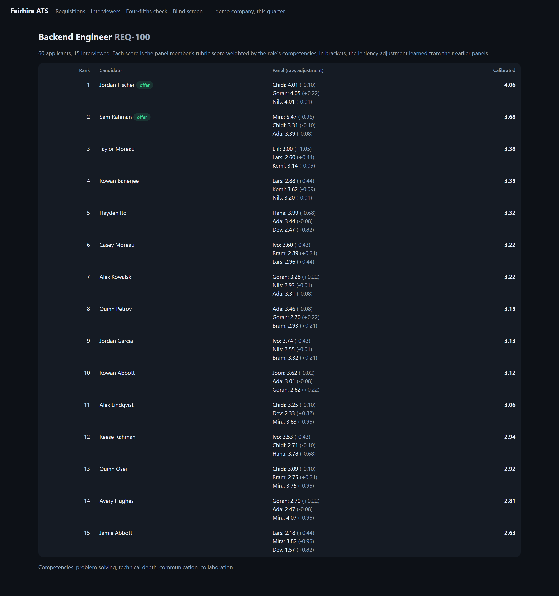
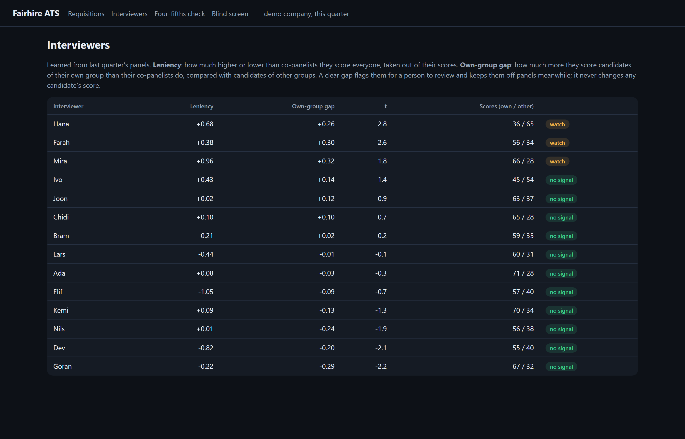
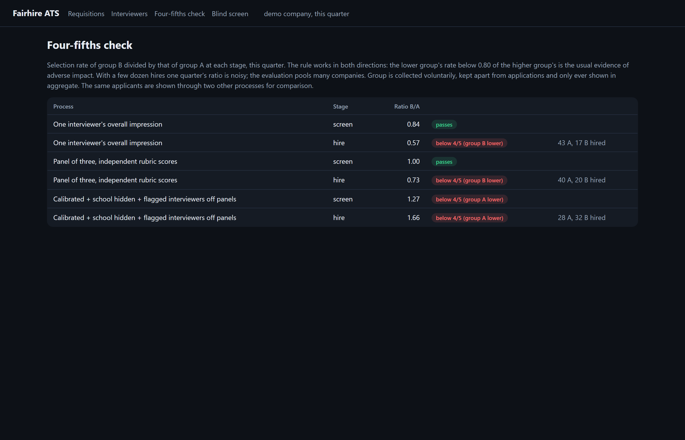

# Recruitment and Applicant Tracking System

[](https://github.com/codeROCK-IZZY/applicant-tracking-system/actions/workflows/ci.yml)


An applicant tracking system built around the part of hiring that decides who gets the job: the interviews.

- **Panels score a rubric independently,** per competency, before any debrief. Each interviewer's **leniency** is
  learned from their earlier panels and taken out, so a candidate who happened to meet two generous interviewers is
  not ahead for that reason.
- **Interviewers are audited against their co-panelists.** Someone who scores candidates of their own group higher
  than colleagues do for the same candidates is flagged for a person to review, and sits out of panels meanwhile.
  Group membership never changes any candidate's score.
- **The school is hidden** from the résumé screen and from the interview packet, and the **four-fifths check** runs
  per stage, in both directions.
- **A blind résumé screen**: identity, contact details and education are removed in code, then Claude records
  evidence per competency, and every level must quote the résumé.



## Results

`ats evaluate --gate` simulates companies hiring. Candidates in both groups have the same ability; group A more
often went to a well-known school. Interviewers differ in leniency, consistency and halo, a quarter favour their own
group, and some give credit for a school. Settings were chosen on 6 tuning companies. These are **15 held-out
companies** (27,000 applicants, 900 hires); quality is the true job performance of the people hired, in standard
deviations of the applicant pool:

| How hires are decided | Hire performance | Hires in the top 10% | Hire rate, group B / group A |
|---|---:|---:|---:|
| One interviewer's overall impression | +0.65 | 40% | 0.67 |
| Panel of three, open debrief | +0.75 | 49% | 0.60 |
| Panel of three, independent rubric scores | +0.80 | 52% | 0.58 |
| Rubric scores, interviewer leniency taken out | +0.88 | 59% | 0.53 |
| **Calibrated + school hidden + flagged interviewers off panels** | **+0.91** | **63%** | **0.97** |

The audit found 37 of 53 biased interviewers with 1 false flag among 157 others. On 8 companies held back with
**more bias and much less history**, the fair process still hired best (+0.92) and reached a ratio of 0.80, but the
audit found only 27 of 66 biased interviewers.

What the numbers show:

- **Independent, calibrated scores pick better people.** Rubric panels beat a single overall impression, and taking
  each interviewer's leniency out added as much again: +0.23 SD over the gut call.
- **Better measurement makes bias more decisive.** Calibration *lowered* the group ratio from 0.58 to 0.53. With the
  noise gone, a consistent bias decides more of the close calls. Precision and fairness are separate problems.
- **Fairness came from removing the bias at its source,** not from adjusting anyone's score: hiding the school and
  keeping flagged interviewers off panels took the ratio from 0.58 to 0.97, and those hires were also the best.
- **The pooled number hides companies where bias remains.** Per company, in both directions, 9 of 15 held-out
  companies were still below four-fifths under the fair process. With no biased interviewers, chance alone would
  explain about 1 of 15; the rest is the bias the audit missed.
- **Two fixes made after the first held-out run, both reported:** the audit wrongly flagged unbiased colleagues of
  a biased interviewer (now it peels off the clearest case first; false flags 3 → 1), and the four-fifths check was
  one-sided. Both are in [ADR 2](docs/adr/0002-hide-school-audit-interviewers.md) with the first run's numbers.

It is a simulation, so read it as a test of the methods, not a forecast (see
[known limitations](docs/known-limitations.md)).



## How it works

```
past panels ─► alternating least squares: candidate level + interviewer leniency (shrunk) ─► leniency per interviewer
past panels ─► each score vs co-panelists' mean, own group vs others ─► flag clearest case, remove, repeat ─► review list
applicants ─► school hidden ─► screen ─► panels of 3 (flagged sit out) ─► rubric scores − leniency ─► offers
every stage ─► selection rate by group (aggregate only) ─► four-fifths check, both directions
résumé ─► redact name, contact, education, birth date ─► Claude: level + quote per competency ─► quotes checked
```

- **Calibration** (`calibrate.py`). Leniency shrinkage chosen on tuning companies. See
  [ADR 1](docs/adr/0001-structured-calibrated-panels.md).
- **Audit** (`calibrate.py`). Thresholds chosen on tuning companies for the highest recall at ≤3% false flags. See
  [ADR 2](docs/adr/0002-hide-school-audit-interviewers.md).
- **Screen** (`screen.py`). `claude-opus-5-5`, low effort, refusal fallbacks, strict tool, quotes required; keyword
  rules without a key. Never rejects on its own. See [ADR 3](docs/adr/0003-evidence-cited-blind-screen.md).



Decisions: [docs/adr](docs/adr). Gaps: [docs/known-limitations.md](docs/known-limitations.md).

## Run it

```bash
python -m venv .venv && . .venv/bin/activate
pip install -e ".[dev]"

ats screen resume.txt            # blind screen (Claude with ANTHROPIC_API_KEY, keyword rules otherwise)
ats interviewers                 # leniency and the own-group audit for the demo company
ats serve                        # the console on http://127.0.0.1:8000
ats evaluate --gate              # eval/reports/report.{md,json,html}
pytest
```

API: `GET /api/reqs`, `GET /api/interviewers`, `POST /api/screen {"resume", "role"}`.

## Tests and CI

- **Core:** a deterministic world where groups differ only in access; each interviewer bias moving scores as
  described (and hidden schools earning nothing); leniency recovered from panels; the audit flagging an interviewer
  who favours their group and not their colleagues; too few scores never flagging; every process seeing the same
  applicants; flagged interviewers sitting out only in the fair process.
- **Services:** the screen **through the real Anthropic SDK** with canned responses (the request shape, nothing
  redacted ever sent, unquoted or out-of-range levels dropped, a refusal falling back to rules), redaction keeping
  year ranges, the console's pages and API, and the CLI.
- **CI:** ruff, `mypy --strict`, tests on Python 3.12 and 3.13, the evaluation gate, the container serving the
  console, and a gitleaks scan of the full history.

## License

MIT
